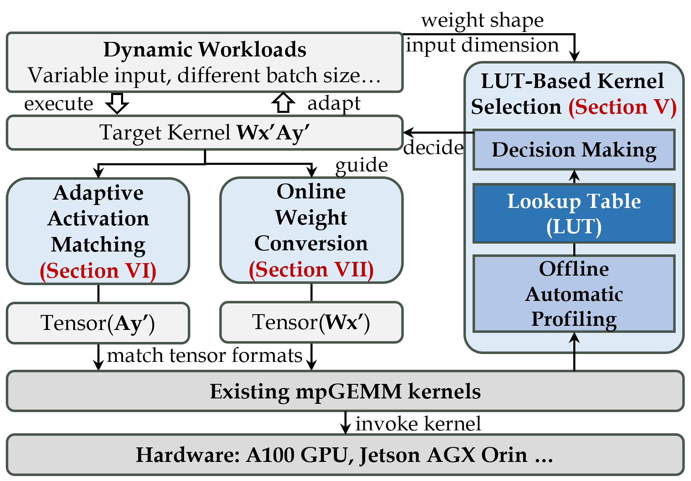
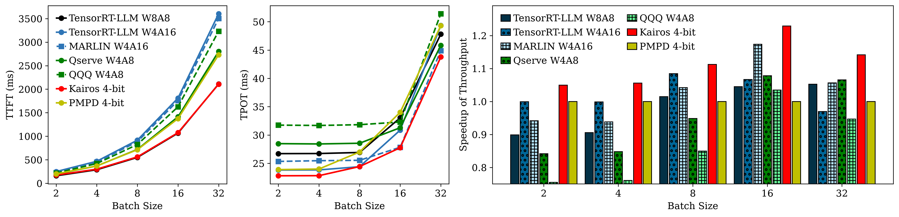
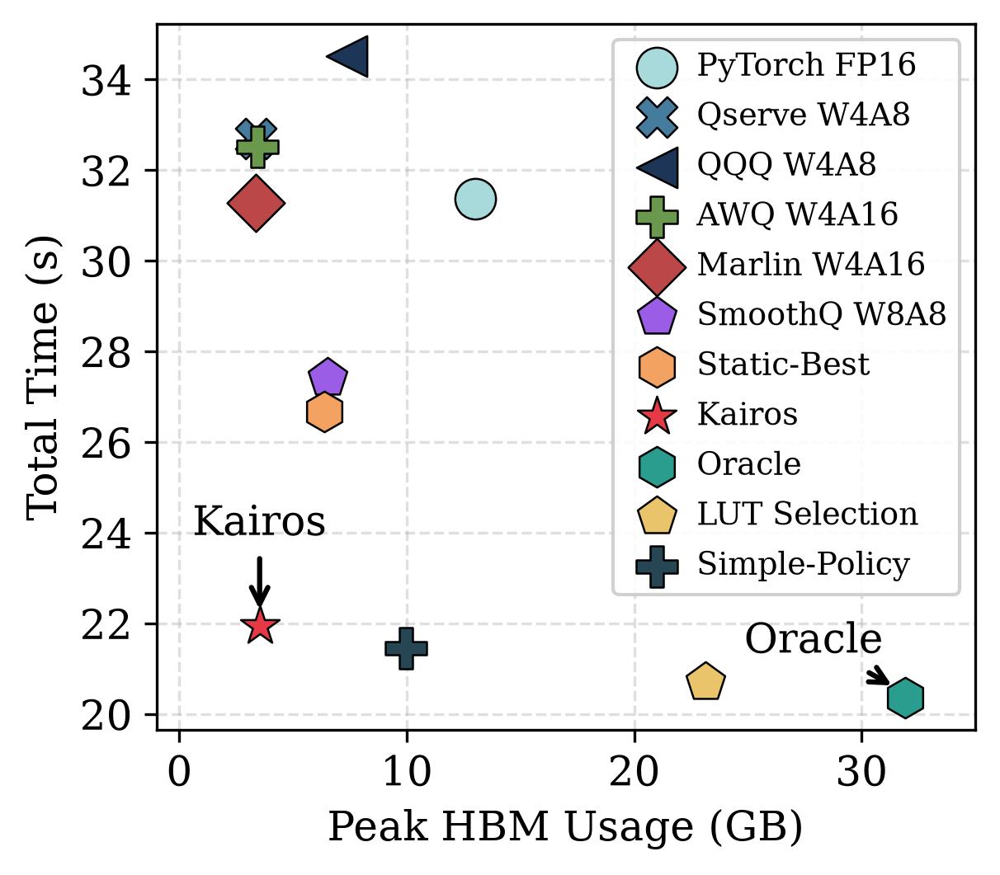

# Kairos
Kairos is a workload-aware mpGEMM kernel switching framework for dynamic AI workloads on GPUs.
Our key idea is to automatically select the most suitable kernel for dynamic workloads.
We first build an offline-profiled, hardware-specific lookup table that maps workload characteristics to the optimal kernel.
Then, we propose an adaptive activation matching method to dynamically align activation bit-widths with the selected kernel.
Finally, we propose a memory-efficient weight conversion method that retains only 4-bit weights in HBM and generates other weight formats on demand.
Evaluations demonstrate that Kairos achieves up to 2.19$\times$ speedup in GEMM workloads, up to 1.51$\times$ faster time-to-first-token (TTFT) and 1.44$\times$ faster time-per-output-token (TPOT) than state-of-the-art mpGEMM frameworks in LLM serving.

# News
02/11/2026 ✨: "Kairos: Switching Mixed-Precision GEMM Kernels for Dynamic AI Workloads" is accepted by HPCA 2027.

# Framework Architecture

<!--   -->

Kairos consists of three core components.

**(1) Kernel Selection.**
To profile the performance of different mpGEMM kernels, Kairos starts with an offline automatic profiling process.
For each target model and GPU, Kairos profiles every unique weight shape across the expected range of M, measures the end‑to‑end latency of all candidate kernels including  switching overhead, and builds a per‑shape interval‑based lookup table (LUT) to record the most suitable one.
At runtime, Kairos detects the current $M$ for each linear layer and queries the LUT to get the target kernel.

**(2) Activation Matching.**
Once the target kernel is selected, Kairos adjusts the activation quantization path accordingly. 
Since activations are dynamically quantized from the preceding operator’s FP16 output, Kairos propagates the required precision to the quantization operator to directly produce the needed format.
When the target precision matches the original FP16, the quantization step is simply skipped. 
This avoids redundant conversions of already‑quantized tensors.

**(3) Weight Conversion.**
To support multiple kernel formats without duplicating weight storage, Kairos retains only a 4‑bit weight format in HBM for each linear layer.
When a switch occurs, Kairos converts the base format on‑the‑fly to the target format using a lightweight dequantization or permute kernel. 
The converted weights are temporarily cached, keeping the peak memory overhead within a negligible fraction of the model size.
Finally, the selected mpGEMM kernel executes with all tensors correctly formatted.
The decision and preparation overheads are consistently amortized by the subsequent kernel performance gain.


## Install
Install environment

1. Install Package for CUDA Device
    `CUDA12.6 + torch2.6`

```
conda create -n kairos python=3.10 -y
conda activate kairos
pip install --upgrade pip
# pip install --extra-index-url https://download.pytorch.org/whl/cu126 torch==2.6.0
pip install --extra-index-url https://mirrors.nju.edu.cn/pytorch/whl/cu126 torch==2.6.0
cd Kairos
pip install -e .
cd thirdparty
git clone https://github.com/IST-DASLab/marlin.git
```

2. Install CUDA 12.6
```
conda install -c "nvidia/label/cuda-12.6.0" cuda-toolkit
```

3. Compile CUDA Kernels

```
sh script/compile_kernel.sh
```

<!-- ## Evaluation
Speedup of Linear Layers Evaluation
```
bash script/linear_layer_speedup.sh
# echo DynamicLinear | python -m eval.eval_llm_linear --model_type llama
```

Speedup of Linear Layers Evaluation

```
bash script/end2end_latency.sh
``` -->

## Performance


We evaluate end‑to‑end LLM serving on Llama3‑8B with input length 1024, output length 512, and batch sizes varying from 2 to 32 to validate switching for both prefilling and decoding.

**TTFT (Prefill).**
As batch size grows, the prefill stage becomes increasingly compute‑bound.
Kairos adapts by switching to compute‑efficient kernels, closely tracking the latency of \(W8A8\). 
It consistently outperforms \(W4A16\), achieving an average speedup of \(1.60\times\) over the \(W4A16\) kernel from TensorRT-LLM and \(1.54\times\) over the MARLIN \(W4A16\).
Since Best-Static is equivalent to solving the maximum throughput across different batch size, the selection of the optimal static baseline will be biased towards the decoding phase.
Kairos achieves an average speedup of \(1.54\times\) over the Best-Static.
Compared to PMPD, Kairos delivers a \(1.24\times\) speedup.

**TPOT and Throughput (Decode).**
In decode phase, Kairos consistently achieves the lowest per‑token latency and the highest throughput across all batch sizes. 
It delivers an average throughput speedup of \(1.09\times\) over both \(W4A16\) kernel from TensorRT-LLM and MARLIN, \(1.18\times\) over QServe, \(1.14\times\) over \(W8A8\) kernel from TensorRT-LLM, and \(1.12\times\) over PMPD, and \(1.07\times\) over Best-Static.
These results further confirm that runtime mpGEMM kernel switching effectively harnesses workload dynamism, not only across different input lengths but also across varying batch sizes.

## Ablation

<!--  -->
To isolate the benefit of dynamic switching, the fidelity of LUT-based decisions, and the time--memory tradeoff, we fix the kernel portfolio, activation matching, GEMV/GEMM thresholds, and runtime framework across all configurations. 
We compare five configurations:

(1) Best Static: the strongest per-layer static policy.
It selects one fixed kernel for each layer across all \(M\).
It represents the upper bound achievable without dynamic switching.

(2) Oracle: dynamic selection using the measured fastest kernel for each \(M\), with all target weight formats resident in HBM. 
It gives an upper bound of dynamic switching while ignoring format-conversion costs and memory.

(3) LUT-Selection: dynamic per-\(M\) selection using the offline LUT, with all target weights resident. 
It measures the fidelity of LUT-based decisions relative to Oracle.

(4) Simple-Policy: a phase-based heuristic that selects one best kernel for prefilling and one for decoding per layer, and keeps all required weight formats
resident in HBM. 

(5) Full Kairos: LUT-based selection and online conversion from the 4-bit base representation. 
It stores only 4-bit weights in HBM and generates other formats on demand.

Oracle achieves the lowest latency but the highest memory (2.45$\times$ FP16), confirming that fine-grained switching without format management is memory-prohibitive.
LUT-Selection is only 1.7\% slower than Oracle, demonstrating high LUT fidelity, and requires lower memory because Oracle selects measured-best kernels outside the offline profiling set.
Simple-Policy runs 2.3\% faster than Kairos but occupies 2.8$\times$ more memory. 
Online weight conversion accounts for only 5.4\% of Kairos's total execution time. 
With just 5\% more memory than static W4A16, Kairos achieves 93\% of Oracle's optimal performance, yielding an excellent time–memory trade-off.